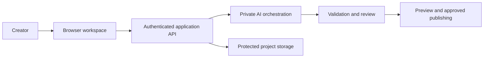

# Public architecture overview

This is a conceptual view, not a production topology or disclosure of internal implementation.

The production README documents Next.js, React, TypeScript, Supabase, MongoDB Atlas, Cloudflare R2 and AI provider integrations. Provider configuration, prompts, schemas, credentials and orchestration internals are intentionally omitted. This diagram does not establish that every integration is live or independently security-audited.
